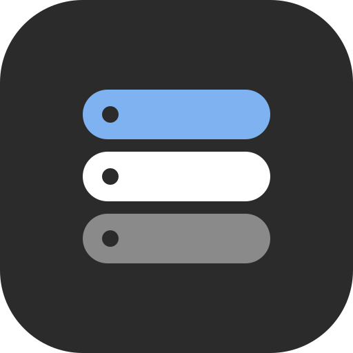
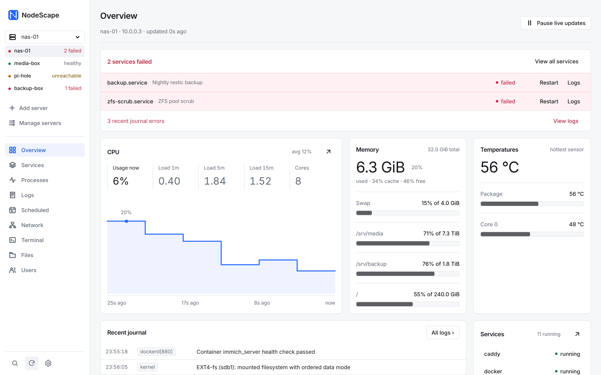
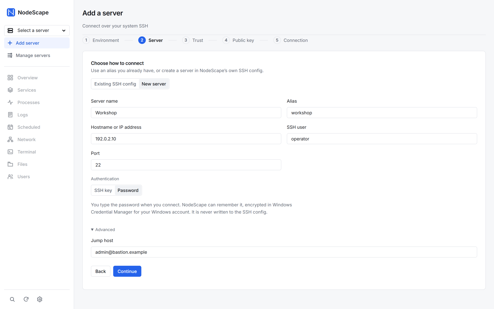
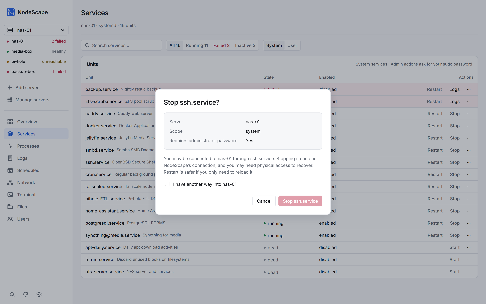

<p align="center"></p>

# NodeScape

NodeScape is a calm desktop control panel for Linux servers over plain SSH. It shows system
health, services, processes, logs, schedules, accounts and network state, with an interactive
terminal and an SFTP file browser. It uses the OpenSSH client already on your PC; nothing is
installed on the server. The app is a Rust/Tauri backend with a framework-free JavaScript UI.

**Website and docs:** the `site/` folder is published with GitHub Pages (see
[Website](#website)). The docs cover installing, adding a server, each page, keyboard
shortcuts, troubleshooting and the security model.



| Connect with a key or a password | Admin actions that read before they run |
| --- | --- |
|  |  |

Screenshots use built-in demo data; every name and address in them is made up.

## Features

- **Problems first.** Failed services and journal errors lead the Overview, with Restart and
  Logs beside them. Healthy things stay quiet.
- **Every server at a glance.** The sidebar shows each saved server's health (healthy,
  N failed, unreachable, needs login), checked every two minutes.
- **Key or password login.** Add a server by host or IP, port and user, with an SSH key or a
  password and an optional jump host. Passwords can be remembered, encrypted in Windows
  Credential Manager. Failures explain themselves, and Show details runs `ssh -v`.
- **Safe admin actions.** Confirmations name the server, scope and sudo need. Sudo passwords
  are used once. Stopping the units your connection depends on needs an explicit confirmation.
- **Keyboard first.** <kbd>Ctrl</kbd>+<kbd>K</kbd> command palette, <kbd>Ctrl</kbd>+<kbd>1</kbd>–<kbd>9</kbd>
  pages, <kbd>/</kbd> to search, arrow keys through tables.

## Install

Download the Windows installer from this repository's Releases page and run it.
Windows needs Microsoft Edge WebView2 Runtime and the OpenSSH client available to your
account. Windows is the primary desktop target; Linux CI checks compilation and tests,
but native Linux installer and desktop behavior still need manual verification.

## First run

1. Open NodeScape. The environment check locates system SSH and ssh-keygen.
2. Choose an alias from an existing SSH config, or add a new server: hostname or IP address,
   port, SSH user, and either an SSH key or a password. For example, alias `workshop`,
   host `box.example`, user `operator`. Under Advanced you can add one jump host.
3. Compare the host fingerprint with a trusted source. The embedded OpenSSH prompt lets
   you approve first contact explicitly. Investigate changed keys with the administrator.
4. Optionally install a public key through the guided terminal. Test the connection
   (password servers ask for the password here) and save the server.

Key logins work through your SSH agent or key files. Password logins are typed when you
connect; tick "Remember on this computer" to keep the password encrypted in Windows
Credential Manager. Profiles store names, targets and config paths, never private keys.
Files opens the SSH account's home directory.
Linux tools such as systemctl, journalctl, ip and sensors provide the displayed data;
missing tools or permissions appear as unavailable. Network inspection is read-only.

## Build from source

Install Node.js 22+, stable Rust, and the platform's Tauri build prerequisites.
On Windows these include Visual Studio C++ Build Tools, the Windows SDK and WebView2.
On Ubuntu install:

```sh
sudo apt-get install build-essential libwebkit2gtk-4.1-dev libssl-dev libxdo-dev librsvg2-dev libayatana-appindicator3-dev patchelf
```

From your checkout:

```sh
npm ci
npm run dev
npm run build
```

The build first scans the shipping frontend (`src/`) for test/demo material and likely
secrets or personal data, then produces installers in `src-tauri/target/release/bundle/`.
The scanner guards against common mistakes; review release contents as well.

## Tests

```sh
npx playwright install chromium
npm test
npm run test:rust
npm run check:release
npm run test:app
```

`npm test` runs the frontend project against a local HTTP server and synthetic fixtures.
It enforces the same CSP as the desktop app and covers every page, charts and xterm.
Set `NODESCAPE_TEST_PORT=4214` to choose the server port (PowerShell:
`$env:NODESCAPE_TEST_PORT = '4214'`).

`npm run test:app` is a separate Windows/WebView2 project, excluded from `npm test`.
It builds the debug app, launches its executable with a free CDP port, attaches Playwright
to the real webview, and tears down the process and temporary profile/WebView2 folders.
Four tests cover first run, real IPC, denied commands and the enforced CSP.
The debug-only `NODESCAPE_CONFIG_DIR` override isolates profiles and managed SSH config;
release builds do not read it. Do not enable remote debugging for normal app use.

To enable the four additional real-host app tests, copy [test.env.example](test.env.example)
to `.env.test.local` at the repository root (`../.env.test.local` from `src-tauri`).
Fill in your local SSH config path, test alias and an existing remote test directory.
Use an unprivileged test account, verify its host key beforehand, and ensure key/agent
authentication works without a prompt. The app tests read Overview, echo a terminal marker,
list the test directory and render Network. Without the env file these tests are skipped.
Settings and host output must never be committed; app tests disable traces, video and screenshots.

Rust real-SSH integration tests are ignored by default. With the same local settings:

```sh
cargo test --manifest-path src-tauri/Cargo.toml -- --ignored
```

Some Rust integration tests create and remove files inside the configured test directory;
never point them at valuable data. CI uses no secrets or real hosts.
Additional release checks:

```sh
cargo fmt --manifest-path src-tauri/Cargo.toml -- --check
cargo clippy --manifest-path src-tauri/Cargo.toml --all-targets -- -D warnings
```

## Security model

- System OpenSSH handles keys, agents, SSH config and known_hosts. Normal connections
  use strict host-key checks; first-contact approval is explicit in OpenSSH's terminal prompt.
- Sudo passwords are requested per action, sent over stdin for a fixed validated operation
  and discarded. Mutations are never automatically retried.
- Login passwords are held in memory for the session and, only if you choose, saved
  encrypted in Windows Credential Manager (Local persistence, never roaming). ssh receives
  them through NodeScape's own askpass mode, which answers password prompts only. No IPC
  command returns a saved password.
- Rust validates IPC inputs. Application commands are enrolled in an ACL manifest and granted
  only to the local main window. Dialog permissions allow only open/save; remote pages get none.
- Scripts and assets are local. CSP blocks inline scripts, eval, frames, forms and external
  connections; inline styles support charts and xterm's generated layout.
- No telemetry, account, cloud service or runtime CDN is required. The app works offline
  from the internet, provided your SSH server is reachable. Dependency downloads and installer
  tooling may need internet access during development or packaging.

See [SECURITY.md](SECURITY.md) for reporting and threat boundaries.

## Website

The project website lives in `site/` (plain HTML and CSS that reuse the app's design tokens).
The [Pages workflow](.github/workflows/pages.yml) copies it, adds the bundled Inter font and
deploys it. To publish: in the repository settings, open **Pages** and set the source to
**GitHub Actions**. Links to the repository adjust to the account and repository name
automatically. To refresh the screenshots, capture them from the demo data in the test
fixtures so that no real server details appear.

## License

NodeScape is licensed under the [Apache License, Version 2.0](LICENSE). See [NOTICE](NOTICE)
for attribution and the bundled third-party components (the Inter font under the SIL Open
Font License 1.1, and xterm.js under the MIT License), whose own license files ship with
the app in `src/fonts/` and `src/vendor/xterm/`.

Unless you state otherwise, any contribution you submit for inclusion is licensed under the
Apache License 2.0, without additional terms or conditions.
